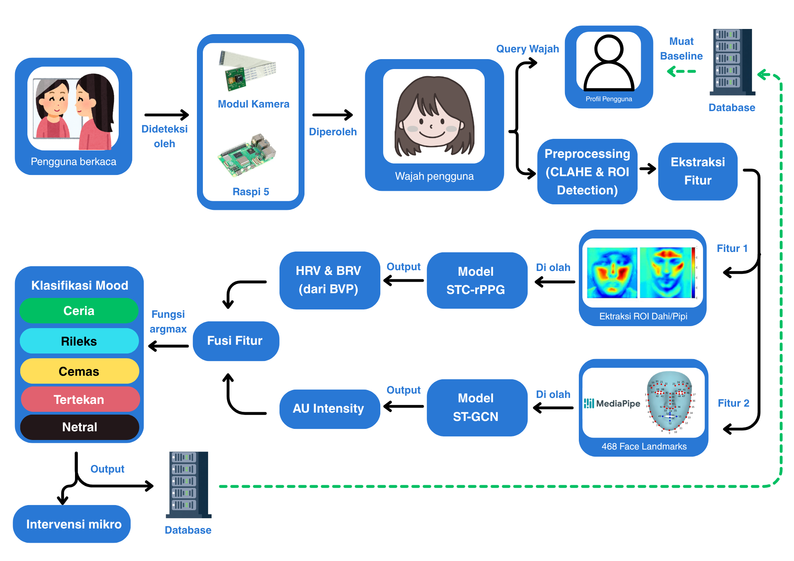

# MoodIn: Smart Mirror untuk Klasifikasi Mood

> Berbasis Graph Convolutional Network + remote Photoplethysmography sebagai Personal Wellness Coach
>
> GEMASTIK XIX — Divisi 9 (Piranti Cerdas dan IoT) · Tim VisionaryX · Institut Teknologi Sepuluh Nopember


---

## Ringkasan

Kesehatan mental merupakan salah satu tantangan pembangunan manusia yang paling mendesak di Indonesia saat ini. Survei Kesehatan Indonesia (SKI) 2023 yang dilaksanakan Kementerian Kesehatan RI terhadap sekitar 345 ribu rumah tangga di 38 provinsi mencatat prevalensi depresi nasional sebesar 1,4%, dengan kelompok usia 15–24 tahun (Generasi Z) menunjukkan prevalensi tertinggi dibanding kelompok usia lain, yaitu 2% [1]. Pada kelompok anak muda pengidap depresi ini, survei yang sama mencatat 61% di antaranya pernah berpikir untuk mengakhiri hidup dalam satu bulan terakhir saat survei dilakukan, namun hanya 10,4% dari kelompok berisiko tinggi ini yang benar-benar mencari pengobatan formal [1], [2].

Temuan yang konsisten lintas survei: kelompok usia produktif-muda menanggung beban gangguan mood tertinggi namun memiliki tingkat pencarian bantuan (help-seeking) paling rendah. Kesenjangan ini berbanding terbalik dengan meningkatnya keterbukaan wacana kesehatan mental di ruang digital — data internal Google Indonesia mencatat kenaikan volume pencarian kata kunci kesehatan mental 70% dan self-care 45% pada masa pandemi [4], dan tren pencarian daring terkait gejala gangguan jiwa berkorelasi dengan kondisi psikologis populasi agregat [5]. Meningkatnya keterbukaan ini belum diikuti akses layanan memadai: jumlah psikolog klinis terbatas, stigma sosial, dan biaya terapi tetap menjadi penghalang struktural.

> Catatan metodologis: perbandingan angka absolut antarsurvei harus hati-hati. Re-analisis Zhafirah & Hastono (UI) menunjukkan saat SKI 2023 dianalisis ulang memakai instrumen SRQ-20 (sama dengan Riskesdas 2018), prevalensi masalah kesehatan jiwa menjadi 2,0% — bukti bahwa perubahan metodologis, bukan semata perbaikan kondisi riil, banyak berkontribusi pada disparitas angka [3].

## Masalah yang Diselesaikan

1. Bagaimana merancang sistem smart mirror yang mengklasifikasikan mood harian pengguna secara non-intrusive dan real-time, dengan menggabungkan analisis ekspresi wajah dan sinyal fisiologis tanpa kontak?
2. Bagaimana merepresentasikan mood ke dalam kerangka dimensional (valence–arousal) menggunakan Graph Convolutional Network, sehingga keluaran lebih kaya informasi dan lebih tahan terhadap keterbatasan model kategori emosi diskrit?
3. Bagaimana merancang mekanisme fusi multimodal yang menggabungkan fitur geometris wajah (dinamika ekspresi pada ruang valence–arousal) dan fitur fisiologis (HRV/BRV dari rPPG) ke dalam satu ruang representasi mood yang konsisten?
4. Bagaimana merancang arsitektur IoT (edge-to-cloud) yang memungkinkan pelacakan tren mood mingguan dan rekomendasi intervensi personal, tanpa mengorbankan privasi data biometrik wajah?

## Cara Kerja Singkat



Alur enam tahap (ringkasan Gambar 1 proposal):

1. **Autentikasi & personalisasi** — pengguna dikenali, profil & preferensi dimuat.
2. **Akuisisi contactless** — video wajah direkam kamera Arducam IMX477 (RGB) di balik two-way mirror; presence-detection memicu sesi.
3. **Pra-pemrosesan** — CLAHE pada ROI wajah, ekstraksi 468 landmark (MediaPipe) lalu disubset ke 68 landmark iBUG sebagai simpul graph.
4. **Ekstraksi fitur ganda** — ST-GCN/Graph-Tran mengestimasi valence–arousal ekspresi (fitur geometris) secara paralel dengan STC-rPPG yang mengestimasi HR/HRV dari sinyal rPPG.
5. **Fusi multimodal & klasifikasi (VA-bridge)** — valence diambil dari ekspresi; arousal difusikan dari arousal ekspresi + fisiologis; satu argmax kuadran pada ruang valence–arousal menghasilkan klasifikasi 5 kelas mood.
6. **Personal wellness coach** — micro-intervention kontekstual + visualisasi tren mood 7 hari.

## Fitur Utama

1. Autentikasi & personalisasi
2. Akuisisi & pra-pemrosesan contactless
3. Ekstraksi fitur ganda (ST-GCN + STC-rPPG)
4. Fusi multimodal & klasifikasi 5 kelas (Ceria, Cemas, Tertekan, Rileks, Netral)
5. Personal wellness coach (micro-intervention + tren 7 hari)

## Struktur Proyek (4 repositori)

| Repo | Fungsi |
| --- | --- |
| **MoodIn-master** (repo ini) | Hub proyek: dokumentasi, proposal, aset, konvensi lintas-repo, kontrak bersama |
| [Hardware-Connections](https://github.com/MoodInBME/Hardware-Connections.git) | Konfigurasi fisik, wiring, enclosure, kamera, daya, protokol komunikasi |
| [Software-Architecture](https://github.com/MoodInBME/Software-Architecture.git) | Model deep learning, feature fusion, training, evaluasi, deployment edge |
| [Interface-Display](https://github.com/MoodInBME/Interface-Display.git) | UI kiosk (PySide6 + QML): navigasi layar, input pengguna, tampilan hasil, tren lokal |

> Slug organisasi GitHub: **MoodInBME** (URL di atas sudah sesuai).

## Struktur Repository Ini

```text
MoodIn-master/
├── README.md
├── LICENSE
├── CONTRIBUTING.md
├── .github/
│   ├── ISSUE_TEMPLATE/
│   │   ├── bug_report.md
│   │   └── task.md
│   └── workflows/
│       └── link-check.yml        # opsional: cek link mati di README
├── docs/
│   ├── proposal/
│   │   ├── Proposal_MoodIn_VisionaryX.pdf
│   │   └── PPT_Gemastik_MoodIn_VisionaryX.pdf
│   ├── assets/
│   │   ├── system-architecture.png     # Gambar 1
│   │   ├── circumplex-model.png        # Gambar 2
│   │   ├── hardware-3d-design.png      # Gambar 3
│   │   └── workflow-diagram.png        # Gambar 4
│   ├── ipc-contract.md              # KANONIK: skema topik & payload MQTT lintas-repo
│   ├── roadmap.md
│   ├── team.md
│   └── sdgs.md
└── CHANGELOG.md
```

## Status Pengerjaan

Diselaraskan dengan tabel progres Bab 3.3 proposal. Isi kolom Progres saat sinkronisasi mingguan (jangan biarkan kosong menjelang evaluasi).

| Komponen | Repo | Progres |
| --- | --- | --- |
| Perakitan hardware, wiring, enclosure | Hardware-Connections | _isi %_ |
| Konfigurasi kamera & uji sinyal (mirror/RGB) | Hardware-Connections | _isi %_ |
| Preprocessing & ekstraksi landmark | Software-Architecture | _isi %_ |
| Model STC-rPPG | Software-Architecture | _isi %_ |
| Model ST-GCN / Graph-Tran | Software-Architecture | _isi %_ |
| Fusi multimodal (VA-bridge) | Software-Architecture | _isi %_ |
| UI kiosk (PySide6 + QML) | Interface-Display | _isi %_ |
| Integrasi end-to-end (MQTT) | Semua | _isi %_ |

## Tim

| Nama | NRP | Peran |
| --- | --- | --- |
| Jeremia Christ Immanuel Manalu | 5023231017 | Ketua |
| Tanuhita Setya Dhanurendra | 5023231026 | Anggota |
| Nozomi Crystalle Padilla Malle | 5023241046 | Anggota |

**Dosen Pembimbing:** Nada Fitrieyatul Hikmah, S.T., M.T.

## Dampak SDGs

SDG 3, 4, 9 — lihat [docs/sdgs.md](docs/sdgs.md).

## Kontrak Antar-Repo (MQTT)

Komunikasi keempat repo memakai satu broker MQTT (TLS, port 8883). Nama topik dan skema payload didefinisikan **sekali** di `docs/ipc-contract.md` (repo ini) sebagai sumber kebenaran; repo lain hanya mereferensikannya. Jangan menduplikasi definisi topik di beberapa repo tanpa menandai salah satu sebagai kanonik.

Topik inti: `moodin/inference/result`, `moodin/signal/quality`, `moodin/presence`, `moodin/ui/command`.

## Konvensi Kerja Lintas Repo

**1. Branching sederhana**

```text
main            → selalu stabil, ini yang dilihat juri
dev             → integrasi kerja mingguan
feat/nama-fitur → branch kerja individual, merge ke dev via PR
```

**2. Konvensi commit message**

```text
feat: tambah modul ekstraksi landmark MediaPipe
fix: perbaiki bug dimensi output STC-rPPG
docs: update BOM dengan harga terbaru
test: tambah unit test preprocessing CLAHE
```

**3. Cross-linking wajib** — di setiap README repo teknis selalu ada baris "Bagian dari proyek MoodIn" beserta tautan ke repo ini, supaya siapa pun yang masuk ke satu repo tetap memahami konteks besarnya.

## Dokumen Lengkap

- [Proposal PDF](docs/proposal/Proposal_MoodIn_VisionaryX.pdf)
- [Slide Presentasi](docs/proposal/PPT_Gemastik_MoodIn_VisionaryX.pdf)

## Lisensi

Lisensi belum final — tetapkan sebelum submission. Pertimbangan: kode `Interface-Display` memuat PySide6 (LGPL-3.0), sehingga repo itu praktis mengikuti LGPL-3.0; repo model & hardware bisa memakai lisensi berbeda (mis. MIT/Apache-2.0 untuk kode, CC-BY untuk dokumen/desain). Cantumkan keputusan final di berkas `LICENSE` masing-masing repo.

## Referensi

[1] Kementerian Kesehatan RI, Badan Kebijakan Pembangunan Kesehatan, "Depresi pada Anak Muda di Indonesia," Factsheet Survei Kesehatan Indonesia (SKI) 2023. https://repository.badankebijakan.kemkes.go.id/id/eprint/5532/1/03%20factsheet%20Keswa_bahasa.pdf

[2] Badan Kebijakan Pembangunan Kesehatan (BKPK) Kemenkes RI, "Potret Sehat Indonesia dari Kacamata SKI 2023," 2024. https://www.badankebijakan.kemkes.go.id/potret-sehat-indonesia-dari-kacamata-ski-2023/

[3] A. Z. Zhafirah dan S. P. Hastono, "Analisis Disparitas Geospasial dan Determinan Sosio-Demografis Masalah Kesehatan Jiwa di Indonesia: Analisis Data Survei Kesehatan Indonesia (SKI) 2023," BIKFOKES, vol. 6, no. 2, 2025. https://scholarhub.ui.ac.id/bikfokes/vol6/iss2/1/

[4] ANTARA News, "Pencarian Google Indonesia soal kesehatan meningkat selama pandemi," 23 Feb. 2021. https://www.antaranews.com/berita/2014332/pencarian-google-indonesia-soal-kesehatan-meningkat-selama-pandemi

[5] U. K. Hisan, M. M. Amri, D. Sulisworo, I. Rahmawati, T. A. Pramesti, "Google Trends Potential for Detecting a Large-scale Mental Health Issue: A Study during Pandemic in Indonesia," Jurnal Aisyah: Jurnal Ilmu Kesehatan, 2023.
