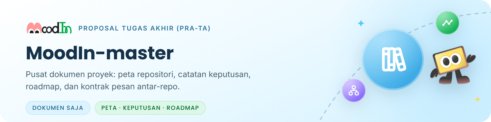
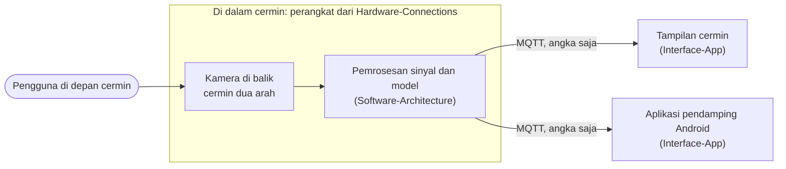

<picture>
  <source media="(prefers-color-scheme: dark)" srcset=".github/readme/banner-dark.png">
  
</picture>

  <a href="#gambaran-sistem">Gambaran sistem</a> ·
  <a href="#peta-repositori">Peta repositori</a> ·
  <a href="#prinsip-lintas-repo">Prinsip</a> ·
  <a href="#milestone">Milestone</a> ·
  <a href="#dokumen">Dokumen</a> ·
  <a href="#tim">Tim</a>

Repositori ini adalah **titik awal** untuk memahami MoodIn, cermin pintar yang memperkirakan kategori suasana hati (_mood_) dan tingkat stres penggunanya tanpa kontak. Isinya hanya dokumen: gambaran sistem, peta repositori, catatan keputusan arsitektur, roadmap, kontrak pesan antar-repo, dan arsip era GEMASTIK. Kode yang dijalankan berada di repositori lain.

MoodIn saat ini dikembangkan sebagai **Proposal Tugas Akhir (Pra-TA)** di Departemen Teknik Biomedik, Fakultas Teknologi Elektro dan Informatika Cerdas (FTEIC), Institut Teknologi Sepuluh Nopember. Rancangannya masih dapat berubah mengikuti hasil bimbingan dengan calon dosen pembimbing.

> [!NOTE]
> Rincian rancangan, yaitu arsitektur model, parameter, target, serta protokol dan instrumen pengambilan data, ada di dokumen Proposal Tugas Akhir dan **belum dipublikasikan**. Judul proposal juga masih dapat berubah.

## Gambaran sistem

Pengguna duduk di depan cermin dua arah selama pemeriksaan singkat. Kamera di balik cermin menangkap video wajah, lalu komputer _edge_ di dalam cermin, NVIDIA Jetson Orin Nano Super, mengolah video itu menjadi dua keluaran yang berjalan berdampingan:

<table>
  <tr>
    <td width="50%" valign="top">
       
      <b>Tingkat stres</b> 
      Diperkirakan dari sinyal denyut yang diekstraksi dari video wajah (rPPG) dan variabilitas denyut jantung (HRV). Pembagian tingkatnya masih dibahas dalam bimbingan.
    </td>
    <td width="50%" valign="top">
       
      <b>Kategori <i>mood</i></b> 
      Diperkirakan dari gerak <i>landmark</i> wajah, lalu dipetakan ke lima kategori: Ceria, Rileks, Netral, Cemas, dan Tertekan. 
      
      
      
      
      
    </td>
  </tr>
</table>

Hasilnya dikirim sebagai angka, bukan gambar, ke tampilan di balik cermin dan ke aplikasi pendamping. Diagram berikut menunjukkan repositori yang menangani setiap bagian:

Format setiap pesan MQTT ditetapkan di MoodIn-master sebagai kontrak antar-repo, sehingga pengirim dan penerima pesan dapat dikembangkan terpisah.

## Peta repositori

<table>
  <tr>
    <th width="64"></th>
    <th align="left">Repositori dan perannya</th>
    <th align="left" width="150">Status</th>
  </tr>
  <tr>
    <td align="center"></td>
    <td><b>MoodIn-master</b> (repositori ini) Dokumen: gambaran sistem, peta repositori, ADR, roadmap, kontrak pesan antar-repo, dan arsip GEMASTIK.</td>
    <td>Aktif</td>
  </tr>
  <tr>
    <td align="center"></td>
    <td><a href="https://github.com/MoodInBME/Software-Architecture"><b>Software-Architecture</b></a> Pemrosesan sinyal dan model: jalur fisiologis untuk tingkat stres dan jalur wajah untuk kategori <i>mood</i>.</td>
    <td>Aktif (M1)</td>
  </tr>
  <tr>
    <td align="center"></td>
    <td><a href="https://github.com/MoodInBME/Hardware-Connections"><b>Hardware-Connections</b></a> Perangkat keras, serta integrasi dan <i>deployment</i> sistem di Jetson.</td>
    <td>Aktif (M2)</td>
  </tr>
  <tr>
    <td align="center"></td>
    <td><a href="https://github.com/MoodInBME/Interface-App"><b>Interface-App</b></a> Aplikasi Flutter: tampilan di balik cermin dan aplikasi pendamping Android.</td>
    <td>Persiapan (M3)</td>
  </tr>
  <tr>
    <td align="center"></td>
    <td><a href="https://github.com/MoodInBME/Interface-Display"><b>Interface-Display</b></a> Antarmuka era GEMASTIK (PySide6 + QML dan kiosk web).</td>
    <td>Arsip</td>
  </tr>
  <tr>
    <td align="center"></td>
    <td><a href="https://github.com/MoodInBME/.github"><b>.github</b></a> Profil organisasi dan berkas komunitas bawaan: panduan kontribusi, kebijakan keamanan, dan templat <i>issue</i>.</td>
    <td>Aktif</td>
  </tr>
</table>

Antar-repositori tidak saling `import`. Modul berkomunikasi lewat MQTT di jaringan lokal sesuai kontrak pesan di [docs/ipc-contract.md](docs/ipc-contract.md). Kontrak itu masih versi era GEMASTIK; kontrak pesan v2 disusun setelah bimbingan.

## Prinsip lintas repo

<table>
  <tr>
    <td width="33%" valign="top">
       
      <b>Diproses di perangkat</b> 
      Video wajah diolah di NVIDIA Jetson Orin Nano Super di dalam cermin.
    </td>
    <td width="33%" valign="top">
       
      <b>Tanpa citra wajah</b> 
      Citra wajah tidak disimpan dan tidak dikirim ke luar perangkat.
    </td>
    <td width="33%" valign="top">
       
      <b>Angka saja</b> 
      Antarmodul hanya bertukar nilai numerik lewat MQTT.
    </td>
  </tr>
  <tr>
    <td width="33%" valign="top">
       
      <b>Bukan alat diagnosis</b> 
      MoodIn adalah prototipe riset, bukan alat diagnosis medis.
    </td>
    <td width="33%" valign="top">
       
      <b>Tanpa dataset di repo</b> 
      Berkas dataset, data partisipan, turunannya, dan data pribadi tidak di-commit.
    </td>
    <td width="33%" valign="top">
       
      <b>Satu penulis commit</b> 
      Sejak tag GEMASTIK, hanya mahasiswa pengusul yang membuat commit (ADR-13).
    </td>
  </tr>
</table>

Prinsip di atas berlaku untuk cara kerja cermin dan isi repositori. Pengambilan data penelitian dengan partisipan diatur oleh protokol yang disetujui Komite Etik Penelitian (KEP) ITS; lihat [docs/etika-dan-data.md](docs/etika-dan-data.md).

## Milestone

Kode milestone yang sama dipakai di semua repositori. Milestone mencakup tahap Pra-TA dan berlanjut ke pelaksanaan Tugas Akhir.

| Kode | Cakupan                                                 | Status                                                                                             |
| ---- | ------------------------------------------------------- | -------------------------------------------------------------------------------------------------- |
| M0   | Arsip GEMASTIK, tata kelola, dan dokumentasi repositori |                        |
| M1   | Jalur fisiologis pada dataset sekunder                  |                    |
| M2   | Perangkat keras dan pengujian di Jetson                 |  |
| M3   | Antarmuka Flutter                                       |                |
| M4   | Jalur wajah                                             |  |
| M5   | Integrasi dan uji sistem                                |                |

Pengambilan data primer, bagian dari M5, baru dimulai setelah persetujuan etik dari KEP ITS terbit. Rincian setiap milestone dan risiko yang dipantau ada di [docs/roadmap.md](docs/roadmap.md).

## Dokumen

<table>
  <tr>
    <td align="center" width="64"></td>
    <td><a href="docs/adr.md"><b>docs/adr.md</b></a> Catatan keputusan arsitektur (ADR) beserta statusnya pada tahap Pra-TA.</td>
  </tr>
  <tr>
    <td align="center"></td>
    <td><a href="docs/roadmap.md"><b>docs/roadmap.md</b></a> Milestone M0–M5 dan risiko yang dipantau.</td>
  </tr>
  <tr>
    <td align="center"></td>
    <td><a href="docs/etika-dan-data.md"><b>docs/etika-dan-data.md</b></a> Etika penelitian, status persetujuan etik, dan aturan data partisipan.</td>
  </tr>
  <tr>
    <td align="center"></td>
    <td><a href="docs/team.md"><b>docs/team.md</b></a> Mahasiswa pengusul, calon dosen pembimbing, dan riwayat tim GEMASTIK.</td>
  </tr>
  <tr>
    <td align="center"></td>
    <td><a href="docs/ipc-contract.md"><b>docs/ipc-contract.md</b></a> Kontrak pesan MQTT v1.0.0 era GEMASTIK; kontrak pesan v2 menyusul.</td>
  </tr>
  <tr>
    <td align="center"></td>
    <td><a href="CHANGELOG.md"><b>CHANGELOG.md</b></a> Riwayat perubahan repositori ini dan ringkasan perubahan lintas repositori.</td>
  </tr>
  <tr>
    <td align="center"></td>
    <td><a href="docs/arsip-gemastik/"><b>docs/arsip-gemastik/</b></a> Proposal, slide, diagram, dan dokumen era GEMASTIK.</td>
  </tr>
</table>

## Tim

Proyek ini dikerjakan oleh **Jeremia Christ Immanuel Manalu** sebagai mahasiswa pengusul Pra-TA, dengan **Nada Fitrieyatul Hikmah, S.T., M.T.** sebagai Calon Dosen Pembimbing 1 dan **Nabila Puspita Firdi, S.T., M.Sc.** sebagai Calon Dosen Pembimbing 2. Dosen pembimbing Tugas Akhir belum ditetapkan secara resmi selama tahap Pra-TA. Rincian peran dan riwayat tim ada di [docs/team.md](docs/team.md).

## Riwayat: GEMASTIK XIX 2026

MoodIn berawal dari proyek tim VisionaryX pada GEMASTIK XIX 2026, Divisi 9 (Piranti Cerdas, Sistem Benam, dan IoT). Versi itu menghasilkan 5 kategori _mood_ dari fusi dua jalur, memakai UI PySide6 + QML, dan MQTT dengan TLS. Isi era itu dibekukan dengan tag [`gemastik-xix-2026`](https://github.com/MoodInBME/MoodIn-master/tree/gemastik-xix-2026) di setiap repositori, dan dokumennya disimpan di [docs/arsip-gemastik/](docs/arsip-gemastik/).

## Lisensi

Berkas [LICENSE](LICENSE) (Apache-2.0) ditetapkan pada era GEMASTIK dan tetap berlaku untuk repositori ini. Lisensi untuk hasil pengembangan berikutnya sedang ditinjau bersama calon dosen pembimbing, termasuk ketentuan HKI ITS. Lisensi hanya berlaku untuk kode dan dokumen di repositori. Data partisipan penelitian tidak termasuk; pemakaiannya hanya mengikuti persetujuan partisipan dan protokol yang disetujui KEP ITS. Dataset publik yang dipakai tetap tunduk pada lisensi atau EULA masing-masing.

---

Departemen Teknik Biomedik · Fakultas Teknologi Elektro dan Informatika Cerdas (FTEIC) 
Institut Teknologi Sepuluh Nopember · Surabaya, Indonesia

  
Ikon antarmuka: <a href="https://tabler.io/icons">Tabler Icons</a> (MIT), lihat <a href=".github/readme/KREDIT.md">kredit aset</a>. Logo, maskot, dan ikon suasana hati: desain tim MoodIn.

